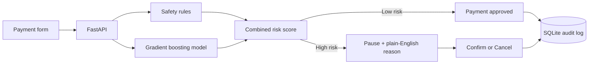
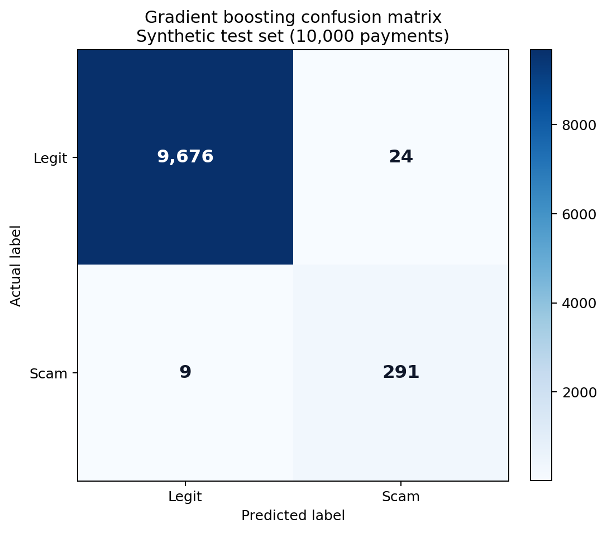
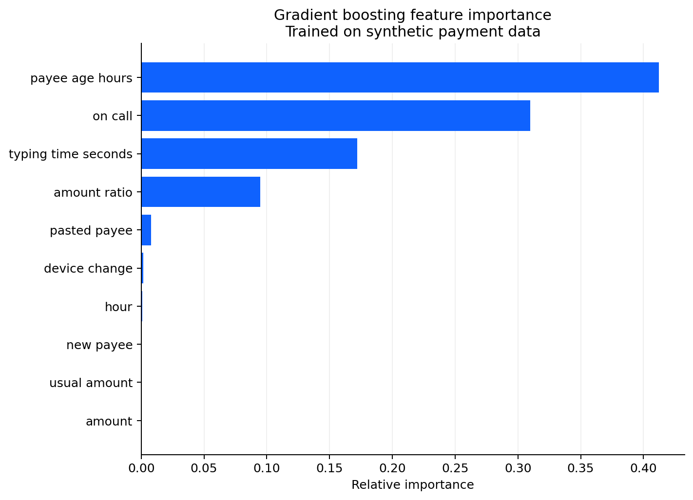

# Payment Shield — real-time scam prevention demo

Payment Shield is a simple end-to-end demonstration for the **IBM Z Datathon 2026** (event code **SSF2026**). It combines a gradient-boosting model with transparent safety rules to assess a bank payment before it is sent. Low-risk payments continue; high-risk payments pause with a plain-English explanation and explicit Confirm or Cancel choices. Every result is written to an audit log.

> **Demo only:** This is not a production fraud system and must not be used to make real financial decisions.

## Architecture



## What is included

- `generate_and_train.py` creates 50,000 synthetic payment records and trains the model.
- `data/payments.csv` is the generated, labelled dataset.
- `artifacts/payment_scam_model.joblib` is the trained scikit-learn model bundle.
- `results.json` contains the model and rules-only metrics, confusion counts, and measured single-decision latency.
- `risk_engine.py` combines the model probability with explainable rules.
- `app.py` serves the payment flow and audit log on port 8000.

## What is new

Banks already show generic scam warnings that most customers click through. Payment Shield is different: it scores behavioural signals - whether the customer is on a phone call, whether the payee details were pasted, hesitation while typing and how recently a new payee was added - inside the payment path, before the money moves. Each decision takes under a millisecond on our LinuxONE server (median 0.46 ms), so the check fits inside a real payment flow. Instead of blocking, it pauses, explains the specific reasons in plain English and lets the customer confirm or cancel, and every score, reason and choice is written to an audit log. It is a targeted intervention at the moment a scam is actually happening, not a static warning banner. All evaluation is on synthetic data (see below).

## Evaluation results (synthetic data)

Both approaches were evaluated on the same deterministic, stratified 10,000-payment test split. F1 is for the scam class.

| Approach | Precision | Recall | F1 |
| --- | ---: | ---: | ---: |
| Gradient boosting model | 0.9238 | 0.9700 | 0.9463 |
| Rules-only baseline | 0.9819 | 0.7233 | 0.8330 |

On the LinuxONE server, 2,000 warmed single-payment `predict_proba` calls had a median latency of **0.4597 ms** and p99 latency of **0.6092 ms** per decision. This measures individual model calls in milliseconds rather than dividing a batch duration by its row count.

The model confusion matrix contains 9,676 true negatives, 24 false positives, 9 false negatives and 291 true positives.





## Run on LinuxONE

```bash
sudo apt-get install -y python3-venv python3-numpy python3-pandas python3-sklearn python3-joblib python3-fastapi python3-uvicorn python3-jinja2 python3-multipart python3-httpx python3-pytest
python3 -m venv --system-site-packages .venv
source .venv/bin/activate
pip install -r requirements.txt
python3 generate_and_train.py
uvicorn app:app --host 0.0.0.0 --port 8000
```

Open `http://SERVER_ADDRESS:8000`. The health check is at `/health`, and the audit log is at `/audit`.

To run the automated checks:

```bash
python3 -m pytest -q
```

## Synthetic dataset disclosure

All payment records are **synthetic and clearly labelled**. No customer, banking or other personal data is used. The generator uses a fixed seed (`2026`) for reproducibility and creates an approximately 3% scam class. Scam examples are more likely—but not guaranteed—to include a new recipient, a newly created payee, an unusual amount or hour, a changed device, pasted details, hesitation and an active phone call. These are demonstration assumptions, not claims about real people.

## Explainability and audit

The final risk score blends the model probability with additive safety rules. When a payment is paused, the explanation is assembled from the highest-importance model features whose safety rules fired. The audit database records the score, reason and final user choice.

## Open source used

- [Python](https://www.python.org/)
- [scikit-learn](https://scikit-learn.org/) - gradient boosting model
- [pandas](https://pandas.pydata.org/)
- [NumPy](https://numpy.org/)
- [joblib](https://joblib.readthedocs.io/)
- [FastAPI](https://fastapi.tiangolo.com/)
- [Uvicorn](https://www.uvicorn.org/)
- [Jinja](https://jinja.palletsprojects.com/)
- [python-multipart](https://github.com/Kludex/python-multipart)
- [SQLite](https://www.sqlite.org/) - audit log
- [HTTPX](https://www.python-httpx.org/) and [pytest](https://docs.pytest.org/) - tests
- [Mermaid](https://mermaid.js.org/) - diagrams

## AI tools used

This project was developed with AI-assisted coding using **Codex / Claude Code**. All generated code, data assumptions and model results should be reviewed by humans before reuse.

