# Payment Shield architecture

Real-time payment scam prevention on IBM LinuxONE: every payment is scored by rules plus a machine-learning model before it leaves, and risky ones pause with a plain-English reason.

Event code: **SSF2026** · IBM Z Datathon 2026

## Problem

In an authorised push payment (APP) scam, the victim is tricked, often by a phone call from someone posing as their bank or the police, into sending money themselves. The bank sees a correctly authenticated, "valid" payment, and instant payments settle in seconds. So the check has to happen in real time, before the money moves. UK losses: £576.4 million across 248,070 APP scam cases in 2025 (UK Finance, [Annual Fraud Report 2026](https://www.ukfinance.org.uk/news-and-insight/press-release/fraud-report-2026-press-release)).

## Diagram

```mermaid
flowchart LR
    customer(["Customer"])

    subgraph vm["IBM LinuxONE VM (s390x, Ubuntu, Python 3.12)"]
        direction LR
        ui["Banking UI<br/>(HTML templates)"]
        api["FastAPI service<br/>port 8000"]
        feat["Feature builder<br/>amount vs usual, new payee,<br/>payee age, hour, device change,<br/>hesitation, pasted payee, on call"]
        rules["Rules engine<br/>additive red-flag points"]
        model["ML model<br/>Gradient Boosting<br/>payment_scam_model.joblib"]
        comb["Risk combiner<br/>score 0-100, pause at 55+"]
        explain["Explanation generator<br/>top 3 fired rules,<br/>ranked by feature importance"]
        sent["Payment approved"]
        pause["Pause screen<br/>plain-English reasons"]
        choice{"Confirm or Cancel?<br/>POST /decision/:id"}
        confirmed["Payment confirmed"]
        cancelled["Payment cancelled"]
        audit[("Audit log<br/>SQLite data/audit.db")]
        auditview["Audit view<br/>GET /audit"]
    end

    subgraph offline["Offline training: generate_and_train.py"]
        direction LR
        gen["Synthetic data generator<br/>50k rows, 3% scams, seed 2026"]
        train["Training + evaluation<br/>80/20 stratified split"]
        out["payment_scam_model.joblib<br/>+ results.json"]
    end

    customer --> ui
    ui -->|"POST /assess"| api
    api --> feat
    feat --> rules
    feat --> model
    rules --> comb
    model --> comb
    comb --> explain
    explain -->|"low risk"| sent
    explain -->|"high risk"| pause
    pause --> choice
    choice -->|"Confirm"| confirmed
    choice -->|"Cancel"| cancelled
    sent -->|"approved"| audit
    pause -->|"paused"| audit
    choice -->|"status updated"| audit
    audit --> auditview

    gen --> train --> out
    out -.->|"loaded by risk engine"| model

    classDef ui fill:#dbeafe,stroke:#2563eb,color:#0f172a
    classDef logic fill:#f1f5f9,stroke:#475569,color:#0f172a
    classDef ml fill:#ede9fe,stroke:#7c3aed,color:#0f172a
    classDef store fill:#fef3c7,stroke:#d97706,color:#0f172a

    class customer,ui,sent,pause,choice,confirmed,cancelled,auditview ui
    class api,feat,rules,comb,explain logic
    class model,gen,train,out ml
    class audit store
```

Source: [`architecture.mmd`](architecture.mmd).

## How a payment flows

1. The customer fills in the payment form (`templates/index.html`), served by FastAPI on port 8000.
2. The form posts to `POST /assess` (`app.py`).
3. `risk_engine.py` builds features, including the amount-to-usual ratio.
4. The Gradient Boosting model returns a scam probability; in parallel, rules add points for red flags such as a large payment during a phone call.
5. The combiner blends them (70% model, 30% rules), with a floor of 70 for a large payment made on a call. A score of 55 or more pauses the payment.
6. Up to three fired rules, ranked by model feature importance, become a plain-English reason.
7. Low risk: approved. High risk: a pause screen with the reasons and Confirm or Cancel (`POST /decision/:id`).
8. Every assessment and the customer's final choice are stored in SQLite (`audit.py`) and shown at `GET /audit`.

## Why rules and ML together

Rules catch known scam scripts, like a coached transfer during a call, and are fully transparent. The model catches combinations of weaker signals that no single rule would flag. The rules also act as a safety net if the model is wrong, and supply the wording for explanations.

## Explainability and human in the loop

The system pauses, it doesn't block. The customer sees exactly why, and makes the final call. This respects their autonomy, and adds friction at the moment a scammer is most likely to be coaching them.

## Why IBM LinuxONE

- Model training and real-time scoring both run on the LinuxONE s390x VM (evidence: `uname -m`, training output, `results.json`).
- Data stays on the platform: the training data, model and audit log never leave the VM.
- Many banks already run core payment processing on IBM Z, so scoring next to the transaction data is the realistic deployment path.

## Results

From `results.json` (10,000 held-out synthetic payments, threshold 0.45):

| Metric | Value |
|---|---|
| Precision | 0.9238 |
| Recall | 0.97 |
| Macro-F1 | 0.9723 |
| Model time per decision | 0.0013 ms |

Time per decision is the median over 20 batch runs of 1,000 payments, divided per payment. It covers model inference only; end-to-end request time is measured by `scripts/collect_evidence.sh`. [Confirm these were produced on the LinuxONE VM: re-run `generate_and_train.py` there and capture the output.]

## Data and responsible AI

The dataset is 100% synthetic; no real customer data is used. The scam rate and behaviour patterns are our assumptions, so the metrics show the pipeline works, not real-world accuracy. This is a prototype, not validated on real bank data.

## Next steps

- Inference on the IBM Z Integrated Accelerator for AI (Telum) at transaction scale, via ONNX or Snap ML
- Pervasive encryption, Secure Execution and crypto cards for production hardening
- Retraining on real bank data under governance, using Confirm/Cancel outcomes as labels
- Confirmation-of-payee integration
- Fairness checks across customer groups

## Tech stack

[Python](https://www.python.org/), [scikit-learn](https://scikit-learn.org/), [pandas](https://pandas.pydata.org/), [NumPy](https://numpy.org/), [joblib](https://joblib.readthedocs.io/), [FastAPI](https://fastapi.tiangolo.com/), [Uvicorn](https://www.uvicorn.org/), [Jinja](https://jinja.palletsprojects.com/), [python-multipart](https://github.com/Kludex/python-multipart), [SQLite](https://www.sqlite.org/), [HTTPX](https://www.python-httpx.org/), [pytest](https://docs.pytest.org/), [Mermaid](https://mermaid.js.org/).

